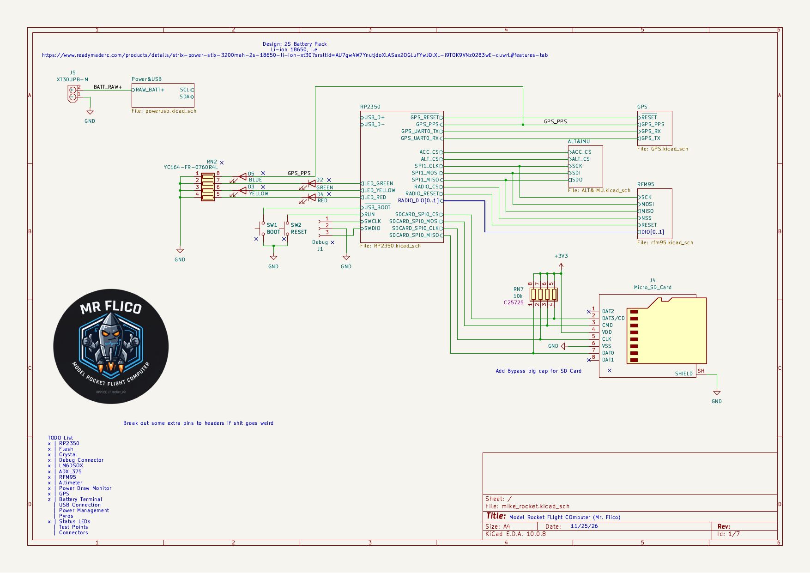

<p align="center">
  
</p>

# mr_flico

**M**odel **R**ocket **FLI**ght **CO**mputer — An RP2350-based avionics PCB designed for high-reliability flight logging, telemetry, and recovery in model and high-power rocketry.

Designed in **KiCad** as the companion hardware for the [`rocket_vR`](https://github.com) Embassy-based Rust flight software.

---

## 📄 Schematics & PCB Documentation

Click the preview below to open the full combined PDF (schematics, composite PCB layers, and 3D renders):

[](docs/mike_rocket_docs.pdf)

> Direct link: [`docs/mike_rocket_docs.pdf`](docs/mike_rocket_docs.pdf)

---

## 🚀 System Architecture & Hardware Specs

| Subsystem | Component / IC | Bus / Interface | Purpose |
| :--- | :--- | :--- | :--- |
| **Microcontroller** | **Raspberry Pi RP2350A** | Core | Dual Cortex-M33 / Hazard3 RISC-V flight computer |
| **Boot & Flash** | **W25Q128JVS** (128 Mbit / 16 MB) | QSPI | Onboard firmware flash & code execution |
| **Telemetry** | **HopeRF RFM95W-915S2** (915 MHz) | SPI1 | LoRa long-range telemetry to ground station |
| **GNSS / GPS** | **u-blox NEO-F10N** (Dual-band L1/L5) | UART0 | Apogee coordinates, landing site tracking |
| **Primary IMU** | **ST LSM6DSOX** (6-DoF) | SPI1 | High-rate attitude estimation, launch detection |
| **Altimeter** | **Bosch BMP581** | SPI1 | High-precision pressure & apogee detection |
| **Power Monitor** | **TI INA3221** | I2C0 | 3-channel voltage & current telemetry |
| **Flight Blackbox** | **MicroSD Card Socket** | SPI0 | Block-aligned high-throughput sensor logging |
| **Power Regulation**| **Dual TPS82140** + **LM74700** | - | Step-down DCDC modules & ideal diode power-path |
| **Connectors** | **USB-C**, **XT30UPB-M**, **Coaxial RF** | - | Programming, battery input, LoRa/GPS antennas |

---

## 🔌 Complete RP2350 Pinout & GPIO Mapping

Verified directly against the schematic netlists (`RP2350.kicad_sch`, `mike_rocket.kicad_sch`):

### General Purpose I/O (GPIO 0 – 25)

| GPIO | Net Name | Direction | Connected Device | Function / Notes |
| :---: | :--- | :---: | :--- | :--- |
| **GPIO 0** | `LED_RED` | Output | D4 (Red LED) | Status / Warning indication |
| **GPIO 1** | `LED_YELLOW` | Output | D3 (Yellow LED) | State / Standby indication |
| **GPIO 2** | `LED_GREEN` | Output | D2 (Green LED) | Power / Ready indication |
| **GPIO 3** | `RADIO_DIO1` | Input | U4 (RFM95W) | LoRa RX/TX timeout / CAD interrupt |
| **GPIO 4** | `SDA` | Bidir | U10 (INA3221) | I2C0 Serial Data (Power Monitor) |
| **GPIO 5** | `SCL` | Output | U10 (INA3221) | I2C0 Serial Clock (Power Monitor) |
| **GPIO 6** | `RADIO_DIO0` | Input | U4 (RFM95W) | LoRa Packet Rx Done / Tx Done interrupt |
| **GPIO 7** | `RADIO_RESET` | Output | U4 (RFM95W) | LoRa active-low hardware reset |
| **GPIO 8** | `SPI1_MISO` | Input | U4, U6, U11 | **Shared SPI1 Bus**: MISO / SDO |
| **GPIO 9** | `RADIO_CS` | Output | U4 (RFM95W) | LoRa Chip Select (`NSS`) |
| **GPIO 10** | `SPI1_CLK` | Output | U4, U6, U11 | **Shared SPI1 Bus**: Serial Clock |
| **GPIO 11** | `SPI1_MOSI` | Output | U4, U6, U11 | **Shared SPI1 Bus**: MOSI / SDI |
| **GPIO 12** | `GPS_UART0_TX` | Output | U5 (NEO-F10N) | UART0 Transmit (RP2350 TX → GPS RX) |
| **GPIO 13** | `GPS_UART0_RX` | Input | U5 (NEO-F10N) | UART0 Receive (GPS TX → RP2350 RX) |
| **GPIO 14** | `5V_EN` | Output | Power Subsystem | 5V DC-DC power rail enable |
| **GPIO 15** | *NC* | - | - | Unconnected / Spare |
| **GPIO 16** | `SDCARD_SPI0_MISO` | Input | J4 (MicroSD) | **SPI0 Bus**: MicroSD Data Out |
| **GPIO 17** | `SDCARD_SPI0_CS` | Output | J4 (MicroSD) | **SPI0 Bus**: MicroSD Chip Select |
| **GPIO 18** | `SDCARD_SPI0_CLK` | Output | J4 (MicroSD) | **SPI0 Bus**: MicroSD Clock |
| **GPIO 19** | `SDCARD_SPI0_MOSI` | Output | J4 (MicroSD) | **SPI0 Bus**: MicroSD Data In |
| **GPIO 20** | `LO_G_CS` / `ACC_CS`| Output | U11 (LSM6DSOX) | 6-DoF IMU Chip Select (on SPI1) |
| **GPIO 21** | `ALT_CS` | Output | U6 (BMP581) | Barometer / Altimeter Chip Select (on SPI1) |
| **GPIO 22** | `HI_G_CS` | Output | Expansion net | High-G Accelerometer Chip Select |
| **GPIO 23** | `HI_G_INT1` | Input | Expansion net | High-G Accelerometer Interrupt |
| **GPIO 24** | `~{GPS_RESET}` | Output | U5 (NEO-F10N) | Active-low GPS hardware reset |
| **GPIO 25** | `GPS_PPS` | Input | U5 (NEO-F10N) | GPS Timepulse / 1PPS synchronization |

### Analog & System Control Pins

| Pin Name | Function | Destination | Notes |
| :--- | :--- | :--- | :--- |
| **GPIO 26–29 / ADC0–3** | Analog Inputs | Unconnected | High-impedance / spare analog channels |
| **USB_DP / USB_DM** | USB D+ / D- | USB-C Port | Native USB 1.1 Host/Device interface |
| **QSPI_SS / CLK / SD0–3** | QSPI Bus | U2 (W25Q128JVS) | 133 MHz Quad-SPI NOR Flash |
| **SWCLK / SWDIO** | ARM Serial Wire Debug | J1 (Debug Header)| 3-pin SWD programming & debugging |
| **RUN** | Hardware Reset | SW2 (RESET) | Tactile push-button with pull-up |
| **~{USB_BOOT}** | Bootloader Select | SW1 (BOOT) | Tactile push-button for ROM bootloader |

---

## 📁 Repository Structure

```text
mr_flico/
├── mike_rocket.kicad_pro    # KiCad project definition
├── mike_rocket.kicad_sch    # Top-level hierarchical schematic sheet
├── mike_rocket.kicad_pcb    # Board layout, stackup, and trace routing
├── RP2350.kicad_sch         # RP2350A MCU, bypass decoupling, crystal, boot circuitry
├── ALT&IMU.kicad_sch        # SPI1 sensors: BMP581 altimeter & LSM6DSOX IMU
├── rfm95.kicad_sch          # SPI1 RFM95W LoRa transceiver and RF coaxial output
├── GPS.kicad_sch            # u-blox NEO-F10N GNSS module, bias-tee, RF input
├── flash.kicad_sch          # W25Q128JVS 16MB QSPI NOR Flash
├── powerusb.kicad_sch       # USB-C, XT30, dual TPS82140 DCDC, INA3221, LM74700
├── rocket.kicad_sym         # Custom schematic symbol library
├── rocket.pretty/           # Custom PCB footprints and embedded 3D STEP models
├── .gitignore               # Excludes backups (*-backups/), cache, and window state
└── README.md                # Project documentation and pinout reference
```

---

## 🛠️ Toolchain & Requirements

* **ECAD**: [KiCad 10.0+](https://www.kicad.org/)
* **Firmware**: Companion firmware is developed in [`rocket_vR`](https://github.com) using **Rust** with the [Embassy](https://embassy.dev/) async embedded framework.
* **3D Models**: Footprint 3D models (`.step` / `.stp`) are stored in `rocket.pretty/` and referenced relatively via `${KIPRJMOD}/rocket.pretty/<model>.step`.

---

## 📄 License

Open-source hardware under the [MIT License](LICENSE) (or CERN-OHL-P).
